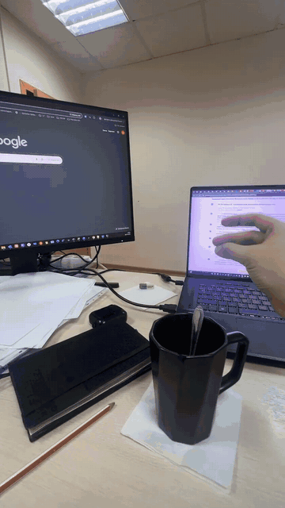

Copyright (C) 2026 Гаврилов Алексей Александрович

# Snap Fingers (Щёлк) - boss key for Windows

Snap your fingers - every window minimizes and the desktop is all that's left. Snap again - everything comes back
exactly as it was. Free and open source (GPLv3).

**[Download for Windows](https://ty-biznesmen.ru/shchelchok)** - free, no sign-up. Windows 10/11, 64-bit.
Русский текст - ниже.



**See it in action (15 s):** https://youtube.com/shorts/6etfBuy2KOQ - two monitors, one snap.

## What it does
- One snap - all windows go down, the desktop is clean ("the boss is coming").
- Snap again - the same windows come back, in the same order. For noisy rooms, Settings can require two or three snaps in a row.
- Works with the built-in laptop mic, a headset or headphones with a mic.
- Learns *your* snap: Settings -> **Set up the snap again** («Настроить щелчок заново»), snap a few times. If it reacts to knocks or typing, move
  the **Sensitivity** («Чувствительность») slider a little to the right.

## Privacy - what the code actually does
- **Sound stays in memory.** The microphone stream arrives in 30 ms blocks (16 kHz, mono). Each block is analysed in
  memory for a sharp click and dropped. Sound is never written to disk and never sent anywhere
  (`shchelchok/audio.py`, `shchelchok/detector.py`). The local log contains only text lines about events (for example, that a snap was recognised), never sound.
- **Network: one thing only - checking for a new version.** About 2 minutes after start and then once a week
  (once a day after a failed check) the program downloads one small file:
  `https://ty-biznesmen.ru/apps/shchelchok/latest.json` (`shchelchok/update.py`, `shchelchok/app_update.py`).
  No identifiers, no statistics are sent - a plain GET. If a new version exists, it asks you; only after you press
  **Update** («Обновить») does it download the installer from the same server and check its SHA-256.
  Turn this off with the **Check for updates** checkbox ("Проверять обновления") in Settings - then the program does not go
  online at all (the **Check now** («Проверить сейчас») button still works when you press it yourself).
- The installer (`loader/loader.py`) downloads the program archive from `https://ty-biznesmen.ru/apps/shchelchok/`
  and checks its SHA-256. Nothing else.
- The "More free programs" («Ещё бесплатные программы») link in the window opens the site in your browser only when you click it.
- `QLocalServer` in `shchelchok/app.py` is a local named pipe that keeps a single copy running; it is not a network socket.

## Build the exe yourself
On Windows 10/11 x64 with **Python 3.12.10**:

```
py -3.12 -m venv venv
venv\Scripts\pip install -r requirements.txt
venv\Scripts\python -m PyInstaller --noconfirm --clean Shchelchok.spec
```

The program appears in `dist\Shchelchok\Shchelchok.exe`. The installer is built separately:

```
cd loader
..\venv\Scripts\python -m PyInstaller --noconfirm --clean --distpath ..\dist --workpath ..\build_loader Setup.spec
```

We build under Wine with the same commands (`tools/wine/build.sh`). PyInstaller output is not byte-for-byte
reproducible (timestamps), so compare behaviour and code, not the hash of your own build.

## Current release
- Version **1.4.6** (this source), released 18.10.2026.
- `Shchelchok-Setup.exe` SHA-256: `7956ec2b4f03c1069a38e5cc9bc6174b460f8b0ed9779778a487dd0a2325065d`
  (same file in [Releases](../../releases/latest) and at https://ty-biznesmen.ru/apps/shchelchok/Shchelchok-Setup.exe).
- Program archive `Shchelchok-1.4.6.zip` SHA-256: `01dfa479b589adc40022c8f6696bf995a130b3162e70a17595ec247076b7f30a`.

Check in PowerShell: `Get-FileHash .\Shchelchok-Setup.exe -Algorithm SHA256`

## License
GNU General Public License v3.0 - see [LICENSE](LICENSE). Third-party components (Qt/PySide6 - LGPL 3.0, sounddevice,
PortAudio, cffi - MIT, Manrope font - OFL 1.1, Python - PSF) and their license texts are in [licenses/](licenses).

Site: **https://ty-biznesmen.ru/shchelchok** · Contact: info@ty-biznesmen.ru

---

# Щёлк - «кнопка босса» для Windows

Щёлкнул пальцами - все окна свернулись, на экране только рабочий стол. Щёлкнул ещё раз - всё вернулось как было.
Бесплатно, исходный код открыт (GPLv3).

**[Скачать для Windows](https://ty-biznesmen.ru/shchelchok)** - бесплатно, без регистрации. Windows 10/11, 64 бит.

## Что делает
- Один щелчок - окна вниз. Ещё один - окна обратно, в том же порядке. Для шумных мест в настройках можно выбрать два
  или три щелчка подряд.
- Микрофон ноутбука, гарнитура или наушники с микрофоном.
- Запоминает именно ваш щелчок: в настройках «Настроить щелчок заново» и щёлкните несколько раз. Срабатывает на стук
  или печать - сдвиньте ползунок «Чувствительность» чуть правее.

## Приватность - что на самом деле делает код
- **Звук живёт только в памяти.** Микрофон отдаёт звук кусками по 30 мс (16 кГц, моно), каждый кусок разбирается в
  памяти и выбрасывается. На диск звук не пишется и никуда не отправляется (`shchelchok/audio.py`,
  `shchelchok/detector.py`). В журнал программы попадают только текстовые строки о событиях (например, что щелчок распознан), звука там нет.
- **В сеть программа ходит за одним - узнать, не вышла ли новая версия.** Через 2 минуты после запуска и дальше раз
  в неделю (после неудачной попытки - через сутки) она скачивает один маленький файл
  `https://ty-biznesmen.ru/apps/shchelchok/latest.json` с номером версии (`shchelchok/update.py`,
  `shchelchok/app_update.py`). Никаких номеров компьютера и статистики не отправляется - обычный GET. Если вышла новая
  версия, программа спрашивает вас; установщик скачивается только после кнопки «Обновить», с проверкой SHA-256.
  Выключается галочкой «Проверять обновления» в настройках - тогда программа в сеть не ходит вовсе (кнопка
  «Проверить сейчас» работает, только когда вы сами её нажали).
- Установщик (`loader/loader.py`) скачивает архив программы с `https://ty-biznesmen.ru/apps/shchelchok/` и проверяет
  SHA-256. Больше ничего.
- Ссылка «Ещё бесплатные программы» в окне открывает сайт в браузере только по нажатию.
- `QLocalServer` в `shchelchok/app.py` - локальный канал, чтобы не запустились две копии; это не сеть.

## Как собрать exe самому
Windows 10/11 x64, **Python 3.12.10**, версии зависимостей зафиксированы в `requirements.txt`:

```
py -3.12 -m venv venv
venv\Scripts\pip install -r requirements.txt
venv\Scripts\python -m PyInstaller --noconfirm --clean Shchelchok.spec
```

Программа - в `dist\Shchelchok\Shchelchok.exe`. Установщик:

```
cd loader
..\venv\Scripts\python -m PyInstaller --noconfirm --clean --distpath ..\dist --workpath ..\build_loader Setup.spec
```

Сборка PyInstaller не совпадает байт в байт (в ней время сборки), поэтому сравнивайте код и поведение, а не сумму
своей сборки.

## Текущий выпуск
- Версия **1.4.6** (этот исходный код), выпуск 18.10.2026.
- `Shchelchok-Setup.exe`, SHA-256: `7956ec2b4f03c1069a38e5cc9bc6174b460f8b0ed9779778a487dd0a2325065d`
- Архив программы `Shchelchok-1.4.6.zip`, SHA-256: `01dfa479b589adc40022c8f6696bf995a130b3162e70a17595ec247076b7f30a`

Проверить в PowerShell: `Get-FileHash .\Shchelchok-Setup.exe -Algorithm SHA256`

## Лицензия
GNU GPL v3.0 - файл [LICENSE](LICENSE). Сторонние компоненты и тексты их лицензий - в папке [licenses/](licenses).

Сайт: **https://ty-biznesmen.ru/shchelchok** · Почта: info@ty-biznesmen.ru
